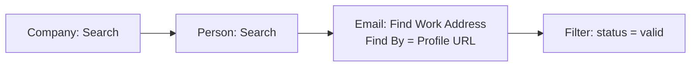

# LeadMagic for n8n


The official [LeadMagic](https://leadmagic.io?utm_source=github&utm_medium=readme&utm_campaign=leadmagic-n8n) community node for [n8n](https://n8n.io). Find and validate work emails, search people, companies, local businesses, and job postings, and enrich B2B records inside any n8n workflow or AI agent.

[npm](https://www.npmjs.com/package/n8n-nodes-leadmagic) · [Workflow templates](https://github.com/LeadMagic/leadmagic-n8n/blob/main/templates/README.md) · [API reference](https://leadmagic.io/docs/api-reference?utm_source=github&utm_medium=readme&utm_campaign=leadmagic-n8n) · [Credits and pricing](https://leadmagic.io/docs/v1/credits?utm_source=github&utm_medium=readme&utm_campaign=leadmagic-n8n) · [Changelog](https://github.com/LeadMagic/leadmagic-n8n/blob/main/CHANGELOG.md)

## Contents

- [Install](#install)
- [Authentication](#authentication)
- [Operations](#operations)
- [Searching and pagination](#searching-and-pagination)
- [Use with AI agents](#use-with-ai-agents)
- [Output modes](#output-modes)
- [Credits, rate limits, and errors](#credits-rate-limits-and-errors)
- [Workflow templates](#workflow-templates)
- [Migrating from the HTTP Request node](#migrating-from-the-http-request-node)
- [Compatibility](#compatibility)
- [Development](#development)
- [Support](#support)

## Install

**Self-hosted n8n:** go to **Settings → Community Nodes → Install**, enter `n8n-nodes-leadmagic`, and confirm. Restart n8n if your deployment requires it. See n8n's [community node installation guide](https://docs.n8n.io/integrations/community-nodes/installation/gui-install/).

**Queue mode or Docker without the GUI:** install the package into the n8n custom extensions folder or your image (`npm install n8n-nodes-leadmagic`), as described in [manual installation](https://docs.n8n.io/integrations/community-nodes/installation/manual-install/).

**n8n Cloud:** community nodes appear in Cloud only after n8n verifies them. Search for "LeadMagic" in the nodes panel; if it isn't there yet, use a self-hosted instance or the HTTP Request node in the meantime.

**Upgrade:** Settings → Community Nodes → `n8n-nodes-leadmagic` → Update. Saved workflows keep working: operation IDs and parameter names are stable across 1.x releases.

## Authentication

1. In LeadMagic, open **Settings → API** and copy your API key (it starts with `lm_`).
2. In n8n, add a **LeadMagic API** credential and paste the key.
3. Click **Test**. The test calls the free `GET /v1/credits` endpoint and uses no credits.

The node sends the key in the `X-API-Key` header to `https://api.leadmagic.io`. Keep keys in n8n credentials only: never put them in expressions, Set nodes, or exported workflow JSON. More in [Authentication](https://leadmagic.io/docs/v1/authentication).

## Operations

| Resource | Operation | Endpoint | What it does |
| --- | --- | --- | --- |
| **Email** | Find Work Address | `POST /v1/people/email-finder` | Verified work email from a name plus company domain or name, or from a profile URL |
| | Validate | `POST /v1/people/email-validation` | Deliverability (`valid`, `invalid`, `unknown`) and mail provider for one address or a list of up to 1,000 |
| | Find Personal Address | `POST /v1/people/personal-email-finder` | Personal emails from a profile URL |
| | Find Work Address From Profile | `POST /v1/people/b2b-profile-email` | Work email from a profile URL (Find Work Address with a profile URL is usually cheaper) |
| **Person** | Search | `POST /v3/people/search` | People by company, title, department, seniority, and location |
| | Find Role | `POST /v1/people/role-finder` | The person holding a title at a company |
| | Find Employees | `POST /v1/people/employee-finder` | Employees of a company |
| | Detect Job Change | `POST /v1/people/job-change-detector` | Whether someone still works at the company you expect |
| **Profile** | Enrich | `POST /v1/people/profile-search` | Title, company, work history, and education from a profile URL |
| | Find From Email | `POST /v1/people/b2b-profile` | Profile URL from an email |
| | Find Mobile | `POST /v1/people/mobile-finder` | Mobile number from a profile URL or email |
| **Company** | Search | `POST /v3/companies/search` | Discover companies by industry, headcount, HQ, funding, and tech stack |
| | Find Lookalikes | `POST /v3/companies/lookalike` | Companies similar to a seed domain, name, or description |
| | Enrich | `POST /v1/companies/company-search` | Firmographics for one company |
| | Get Funding | `POST /v1/companies/company-funding` | Funding rounds, investors, acquisitions, and news |
| | Get Technographics | `POST /v1/companies/technographics` | Technologies a company uses |
| | Find Competitors | `POST /v1/companies/competitors-search` | Competitors of a company |
| **Local Lead** | Search | `POST /v3/local-leads/search` | Local businesses by place, category, name, or map radius, with phones, emails, and websites |
| | Get Categories | `GET /v3/local-leads/categories` | Category names for Local Leads search (free) |
| **Job** | Search | `POST /v3/jobs/search` | Job postings by title, company, location, seniority, and date, as hiring signals |
| | Find (Legacy) | `POST /v1/jobs/jobs-finder` | The V1 jobs finder, kept for existing workflows |
| | Get Countries, Regions, Types, Industries, Company Types | `GET /v1/jobs/*` | ID lists for the legacy finder (free) |
| **Advertisement** | Search Google Ads, Search Meta Ads, Search B2B Ads | `POST /v1/ads/*-search` | A company's ads, with an optional Max Ads limit |
| | Get B2B Ad Details | `POST /v1/ads/b2b-ads-details` | Targeting and impressions for one B2B ad URL |
| **Credit** | Get Balance | `GET /v1/credits` | Remaining credits (free) |

Every operation has a page in the [API reference](https://leadmagic.io/docs/api-reference) with the full request and response fields. For endpoints the node does not cover yet (bulk jobs, account analytics), use the HTTP Request node with your LeadMagic credential, as shown in [Migrating from the HTTP Request node](#migrating-from-the-http-request-node).

### Search returns profiles, not contact details

People Search and Company Search return records, never emails or phone numbers. Chain them:



The [ICP accounts to verified contacts](https://github.com/LeadMagic/leadmagic-n8n/blob/main/templates/icp-accounts-to-verified-contacts.json) template wires this up end to end.

## Searching and pagination

The five search operations (Person Search, Company Search, Find Lookalikes, Local Lead Search, Job Search) share the same controls:

| Field | Behaviour |
| --- | --- |
| **Return All** | Follows LeadMagic's cursor (or offset, for lookalikes) until there are no more results. Stops after 200 pages as a safety limit. |
| **Limit** | Max results to return when Return All is off. The node requests full pages (50, 100 for lookalikes, a fixed 25 for local leads) and trims the last one, so you are not charged for records it would drop. |
| **Split Into Items** | On (default): one n8n item per person, company, business, or job. Off: one item per API page, including `warnings`, `ignored_filters`, and pagination metadata. |
| **Filters** | The common filters, as form fields. Comma-separated lists become arrays. |
| **Additional Request Fields (JSON)** | Any other documented field, for example `{"people_filters": {"is_sales": true}}`. Nested filter objects are merged with the form fields. |

Check `ignored_filters` and `warnings` (turn Split Into Items off) when results look too broad: the API reports any criteria it could not apply. Search is free within fair use on Professional and Ultimate plans; other plans pay per record returned, so keep a Limit while testing.

## Use with AI agents

The node is usable as an AI tool. In an **AI Agent** node, add a tool and pick **LeadMagic**, then choose the operation. Let the model fill inputs with `$fromAI()`:

```text
Company Domain: {{ $fromAI('company_domain', 'Company website domain, e.g. example.com', 'string') }}
```

Tips:

- Give each tool a clear **Description** (what it returns and what it costs), so the agent picks the right one.
- Use **Output → Selected Fields** or **Simplified** to keep responses small. The agent's context fills up fast with raw search pages.
- Tell the agent in its system message to find emails only when asked. Every paid call uses credits.

See the [AI account research agent](https://github.com/LeadMagic/leadmagic-n8n/blob/main/templates/ai-account-research-agent.json) template.

## Output modes

| Mode | Use it for |
| --- | --- |
| **Raw** (default) | The full API response. Best for mapping fields in later nodes. |
| **Simplified** | Up to 10 useful fields per object, with nesting capped at five levels. Best for AI agents and Slack messages. |
| **Selected Fields** | Only the top-level fields you pick, plus any ID fields. Add unlisted fields as a comma-separated list. |

In search operations with Split Into Items on, the mode applies to each record.

## Credits, rate limits, and errors

**Credits.** Costs depend on the operation and your plan. Most lookups charge only when they return data: Email Finder charges for a valid email, Email Validation for a `valid` or `invalid` result, and `unknown` (including catch-all domains) is free. Current prices are on the [credits page](https://leadmagic.io/docs/v1/credits). Email Finder results are already validated, so don't validate them again.

**Rate limits.** Email Finder and Email Validation each allow 300 requests per minute on Basic and Essential, 600 on Growth, 1,000 on Professional, and 1,500 on Ultimate, shared across all your keys. A `429` costs nothing. For lists, use **Loop Over Items** with a **Wait** node (the bulk Google Sheets template paces 5 rows per second). See [rate limits](https://leadmagic.io/help/api-usage/api-rate-limits).

**Errors.** The node shows LeadMagic's error code and next step, for example `LeadMagic request failed (HTTP 402, insufficient_credits)`, plus the request ID for support. It never includes your key, headers, or request body. Requests time out after 30 seconds (60 for searches) and are never retried automatically, because a timed-out paid request may already have been charged.

| Status | Meaning | What to do |
| --- | --- | --- |
| 400 | A parameter is missing or malformed | Fix the input for that item |
| 401 | Missing or invalid API key | Check the credential. Repeated bad keys are locked out for 15 minutes, then longer |
| 402 | Out of credits, or the account is paused | Add credits, then rerun |
| 410 | Local Leads cursor expired (after 30 minutes) | Rerun the search |
| 429 | Rate limit | Wait, lower concurrency, or add a Wait node |

To keep going when one item fails, open the node's **Settings** and set **On Error** to **Continue (using error output)**. Failed items go to a second output with an `error` field, so you can log them instead of losing them. A not-found result is not an error: Email Finder returns `status: null` and the workflow continues.

## Workflow templates

Eight ready-to-import workflows, built for n8n 2.47 with current node versions and setup notes on the canvas:

| Template | What it does |
| --- | --- |
| [Bulk work-email finder for Google Sheets](https://github.com/LeadMagic/leadmagic-n8n/blob/main/templates/bulk-email-finder-google-sheets.json) | Fills missing emails in a sheet with paced batches, per-row status, and resumable reruns |
| [ICP accounts to verified contacts](https://github.com/LeadMagic/leadmagic-n8n/blob/main/templates/icp-accounts-to-verified-contacts.json) | Company Search → People Search → Email Finder → Google Sheets |
| [Lookalike account expansion](https://github.com/LeadMagic/leadmagic-n8n/blob/main/templates/lookalike-account-expansion.json) | Best-customer domains → scored lookalikes → deduplicated sheet |
| [Hiring signals to Slack](https://github.com/LeadMagic/leadmagic-n8n/blob/main/templates/hiring-signals-to-slack.json) | Daily Job Search → buyer → email → Slack, alerting each company once |
| [Local business leads](https://github.com/LeadMagic/leadmagic-n8n/blob/main/templates/local-business-leads-to-sheet.json) | Local Leads by city and category → validated emails → upserted rows |
| [Champion job-change alerts](https://github.com/LeadMagic/leadmagic-n8n/blob/main/templates/champion-job-change-alerts.json) | Weekly job-change checks → new work email → Slack |
| [AI account research agent](https://github.com/LeadMagic/leadmagic-n8n/blob/main/templates/ai-account-research-agent.json) | A chat agent with LeadMagic tools for enrichment, search, and email |
| [Real-time enrichment API](https://github.com/LeadMagic/leadmagic-n8n/blob/main/templates/realtime-enrichment-webhook.json) | Webhook → email + firmographics, with 404 and 502 responses |

Import: copy the file's raw URL and use **Workflow menu → Import from URL**, or download it and use **Import from File**. Then select your credentials. Details in the [template guide](https://github.com/LeadMagic/leadmagic-n8n/blob/main/templates/README.md).

## Migrating from the HTTP Request node

Workflows that call LeadMagic through the HTTP Request node keep working. The native node adds credential testing, typed fields, pagination, AI-tool support, and readable errors. To migrate a step:

1. Add a LeadMagic node with the matching operation (see the endpoint column in [Operations](#operations)).
2. Map the same fields. For Email Finder, `first_name`, `last_name`, and `domain` map to the fields of the same name.
3. Remove any `X-API-Key` header and select the LeadMagic credential instead. If a key was ever pasted into a shared workflow, rotate it in LeadMagic.
4. Replace hand-built status checks with the node's error output (see [errors](#credits-rate-limits-and-errors)).

For endpoints the node does not cover, keep the HTTP Request node and set **Authentication → Predefined Credential Type → LeadMagic API**, so the key stays in the credential.

## Compatibility

- Built and tested against n8n 2.47 (current stable). Requires an n8n version that supports community nodes and AI tools.
- Node.js 22 or newer for development.
- No runtime dependencies. The package uses only n8n's HTTP helpers, with no filesystem or environment-variable access.
- Published from GitHub Actions with an npm [provenance attestation](https://www.npmjs.com/package/n8n-nodes-leadmagic#provenance), as n8n requires for verified nodes.

## Development

```bash
pnpm install --frozen-lockfile
pnpm build      # n8n-node build
pnpm lint       # n8n-node lint (strict, same rules as n8n verification)
pnpm test       # builds, then runs mocked tests; no API calls or credits
pnpm dev        # starts n8n with the node loaded, for manual testing
python3 scripts/build-templates.py   # regenerates templates/ (validated by pnpm test)
```

Use pnpm 10.33.0. Release steps are in [RELEASING.md](https://github.com/LeadMagic/leadmagic-n8n/blob/main/RELEASING.md).

## Support

- Questions and bugs: [open an issue](https://github.com/LeadMagic/leadmagic-n8n/issues) with sanitized steps to reproduce. Never include API keys or personal data.
- Account and billing: [support@leadmagic.io](mailto:support@leadmagic.io).
- Security: report privately to [security@leadmagic.io](mailto:security@leadmagic.io).

Related: [LeadMagic API docs](https://leadmagic.io/docs) · [OpenAPI schema](https://github.com/LeadMagic/leadmagic-openapi) · [Agent skills](https://github.com/LeadMagic/leadmagic-skills)

[MIT license](https://github.com/LeadMagic/leadmagic-n8n/blob/main/LICENSE) · [Third-party notices and contribution policy](https://github.com/LeadMagic/leadmagic-n8n/blob/main/LICENSE-NOTES.md) · [Public content policy](https://github.com/LeadMagic/leadmagic-n8n/blob/main/PUBLICATION.md)
